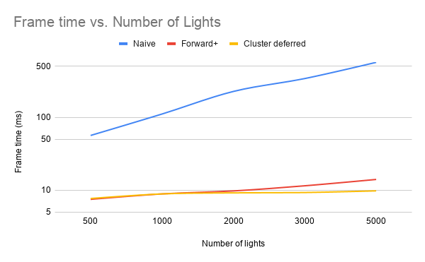
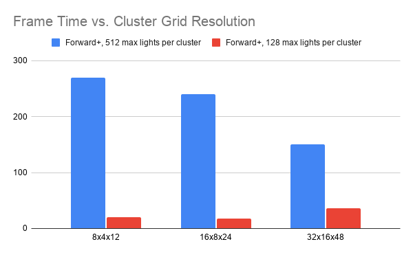

WebGL Forward+ and Clustered Deferred Shading
======================

**University of Pennsylvania, CIS 565: GPU Programming and Architecture, Project 4**

* Rin Fukuoka
* Tested on: Windows 11, i9-13900HX @ 2.20 GHz, 32GB RAM, RTX 4080 Laptop GPU 12GB

### Live Demo HERE 

In this project, I implemented three different rendering methods to render a scene with many lights using TypeScript and WebGPU. Below are my implementations, each building on the previous one:

**Naive Forward:** Everything is rendered in one pass. We must compute lighting for every fragment in the scene (including ones later hidden by closer geometry), and every time lighting is calculated, we must iterate through all lights in the scene.

**Forward+/Clustered Forward:** We divide the viewing frustum into a 3D grid of clusters along x, y, and z. In the compute pass, we calculate the lights each cluster contains, and in the shading pass, each fragment only considers lights in the cluster it falls in.

**Clustered Deferred:** In addition to the clustering, we implement a G-buffer. We first calculate a G-buffer pass to store the position, color, and normal of each pixel into textures. In the final shading pass, we read from these textures and shade using the clusters. Thus, we only need to compute expensive lighting on visible pixels rather than all geometry, and only consider lights in each pixel's cluster.
 
### Performance Analysis
All tests were run on the Sponza scene at a 2560 × 1350 canvas resolution. Each value is the average frame time (ms) over 30 frames. Workgroup size was 128 the light movement/clustering compute pass. 

#### Number of Lights 

Tested with a 16 × 9 × 24 cluster grid and 128 max lights per cluster.

Naive rendering scales almost linearly with light count. This makes sense, given every fragment loops over all N lights, so the per-frame cost is O(pixels × lights). 

Forward+ and Clustered Deferred are much faster at every light count. At 5000 lights, they are about 40-50× faster than Naive, since each fragment only loops over the lights in its own cluster.
The two methods perform similarly up to about 2000 lights, after which Clustered Deferred is faster. With more lights, each cluster's light list grows, which makes every shaded fragment's loop more expensive. Forward+ runs this loop for every fragment it rasterizes, including overdrawn ones that later get covered by closer geometry. Clustered Deferred writes geometry to the G-buffer first and then runs the light loop exactly once per visible pixel, so the growing per-light cost is paid far fewer times. At low light counts, the G-buffer pass's extra memory and bandwidth roughly cancels out this advantage, which is why the two likely match early on. 

####  Max Lights per Cluster Artifacts 

As shown in the image, grid-like artifacts can appear when there are many lights. Each cluster has a maxLightsPerCluster cap, so when more lights overlap a cluster than the cap allows, the extras are dropped. This leaves sharp edge artifacts in the lighting along cluster boundaries. Raising maxLightsPerCluster removes the artifacts, but at the cost of performance. 

#### Grid Size 

Used forward plus rendering with 5000 lights. Tested for both 512 / 128 max lights per cluster. 

With a 512 max lights per cluster cap, finer grids run faster. Larger clusters overlap more lights, so each fragment has to loop over hundreds of lights. Smaller clusters keep those per-cluster light numbers small. 
With a 128 max lights per cluster cap, frame times are much lower, but the speedup also comes from dropping lights. Coarse clusters overflow the max lights cap, so some lights are never shaded and grid artifacts appear, as discussed above. Since the per-cluster loops are already capped and cheap, the clustering compute pass becomes the bottleneck at the finest grid of 32x16x48. 

### Credits

- [Vite](https://vitejs.dev/)
- [loaders.gl](https://loaders.gl/)
- [dat.GUI](https://github.com/dataarts/dat.gui)
- [stats.js](https://github.com/mrdoob/stats.js)
- [wgpu-matrix](https://github.com/greggman/wgpu-matrix)
